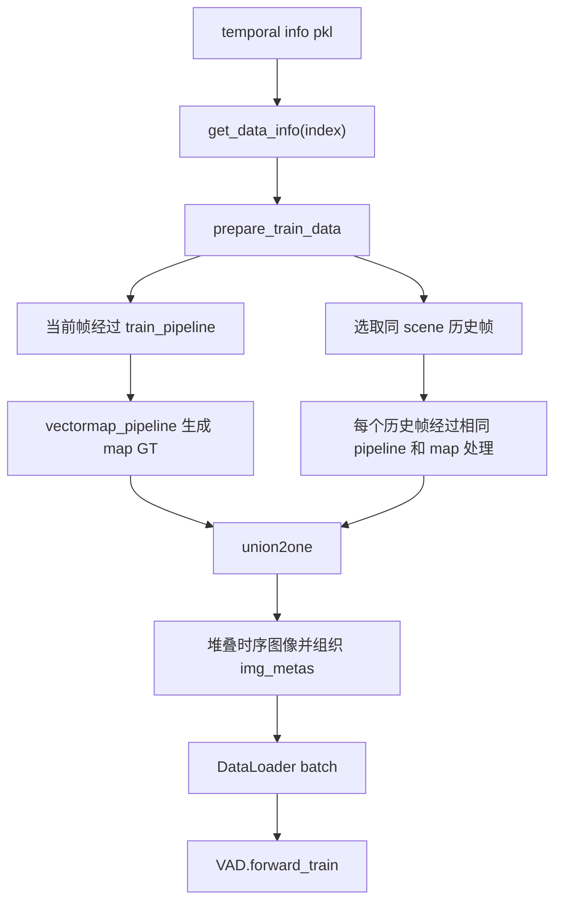

# 00：VAD 数据流总览

本节先建立数据如何从 temporal info pkl 进入 VAD 模型的整体图景。后续章节会逐段展开 Dataset、pipeline transforms、向量地图和模型输入。

## 1. 配置入口

以 `projects/configs/VAD/VAD_tiny_e2e.py` 为例：

```python
dataset_type = 'VADCustomNuScenesDataset'
queue_length = 3

train_pipeline = [
    LoadMultiViewImageFromFiles,
    PhotoMetricDistortionMultiViewImage,
    LoadAnnotations3D,
    CustomObjectRangeFilter,
    CustomObjectNameFilter,
    NormalizeMultiviewImage,
    RandomScaleImageMultiViewImage,
    PadMultiViewImage,
    CustomDefaultFormatBundle3D,
    CustomCollect3D,
]
```

实际配置用 `dict(type=...)` 表示每个 transform；上面省略了参数，只突出执行顺序。

训练数据使用 `vad_nuscenes_infos_temporal_train.pkl`，Dataset 类型为 `VADCustomNuScenesDataset`。`queue_length=3` 控制一个样本里组织的时序帧数。

## 2. 训练数据流



对应实现：

| 环节 | 代码位置 |
|---|---|
| 训练 transforms 和 `queue_length` | `projects/configs/VAD/VAD_tiny_e2e.py::train_pipeline`、`data.train` |
| 构造单帧输入 | `projects/mmdet3d_plugin/datasets/nuscenes_vad_dataset.py::get_data_info()` |
| 取当前帧和历史帧 | `VADCustomNuScenesDataset.prepare_train_data()` |
| 生成向量地图监督 | `VADCustomNuScenesDataset.vectormap_pipeline()` |
| 合并时序输入 | `VADCustomNuScenesDataset.union2one()` |
| 消费历史帧和当前帧 | `projects/mmdet3d_plugin/VAD/VAD.py::forward_train()` |

## 3. 与 UniAD 数据管线的增量差异

沿用你在 UniAD 中学过的多相机读取、图像增强、标注加载、格式化和 collect 概念。VAD 这一段的新重点是：

1. **没有 occupancy 标签生成环节。** VAD 的配置 pipeline 中没有 `GenerateOccFlowLabels`。
2. **地图标签在 pipeline 外追加。** `prepare_train_data()` 先运行 `self.pipeline(input_dict)`，再调用 `self.vectormap_pipeline(example, input_dict)`。因此向量地图不是 `LoadAnnotations3D` 读出来的普通 3D box 标注。
3. **时序帧由 Dataset 合并。** 每帧单独经过 transforms，之后 `union2one()` 把图像沿时间维堆叠，并为每帧准备 `img_metas`。
4. **训练时区分历史帧和当前帧。** `VAD.forward_train()` 用历史帧计算 `prev_bev`，再对当前帧运行带监督的 head。

## 4. 先记住的张量维度

单帧经过 `CustomDefaultFormatBundle3D` 后，图像按相机堆叠，概念维度为：

```text
[N_cam, C, H, W]
```

`union2one()` 将一条时序样本堆成：

```text
[T, N_cam, C, H, W]
```

经过 DataLoader 后，模型训练入口按 batch 维接收：

```text
img: [B, T, N_cam, C, H, W]
```

具体 `H/W` 会受配置中的缩放和 padding 影响，后续 transforms 一节再逐步推导。

## 5. 两个需要特别留意的实现细节

- `queue_length=3` 时，代码从目标帧之前的候选帧中做时序采样，再与当前帧组成 queue。候选帧必须属于同一 scene；确切采样和排序逻辑在第 01 节展开。
- `vectormap_pipeline()` 在训练时会被调用。测试时由 `is_vis_on_test` 控制；当前 Dataset 构造函数把它设为 `True`，所以本仓库默认测试路径也会追加向量地图结果。预测阶段与评估阶段如何使用这些结果，后续结合 Dataset 的评估代码再看。

## 6. 本节结论

先把 VAD 的 Dataset 主干记成：

```text
读单帧信息 → 组成时序 queue → 每帧做图像/检测标注处理
→ 额外生成向量地图 GT → 合并时序图像 → 交给模型
```

## 7. 源码

- 配置：`projects/configs/VAD/VAD_tiny_e2e.py`
- Dataset：`projects/mmdet3d_plugin/datasets/nuscenes_vad_dataset.py`
- Detector：`projects/mmdet3d_plugin/VAD/VAD.py`
